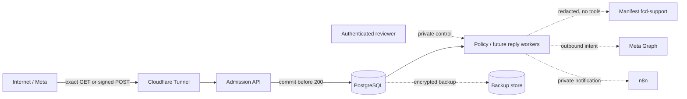

# Fast Cyber Defense Support Threat Model

Status: reviewed Phase 0 architecture threat model (`P0-017`)

Reviewed: 2026-08-27 (Asia/Dhaka)

Scope: the public Meta webhook boundary, the current admission and Phase 3A
policy core, and the planned private model, automation, outbound, lifecycle,
backup, and operational paths. This is an architecture threat model, not a
claim that every planned control is implemented and not a vulnerability audit.

## 1. Overview

### Security summary

The service accepts attacker-controlled Internet traffic only on the exact Meta
verification and event callback. Signed events cross into the application as
unmodified bytes, are verified before parsing, and are acknowledged only after
minimal PostgreSQL persistence. PostgreSQL is the authority for conversation,
takeover, consent, lifecycle, deletion, and future outbound state. Manifest and
n8n are private downstream services and must never become authorities for that
state. The production WhatsApp number is outside the present test scope.

The repository already implements the narrow webhook admission and Phase 3A
policy core. Lifecycle jobs, verified deletion, backup/restore enforcement,
model calls, outbound providers, and n8n integration remain planned controls.
The acceptance matrix records their evidence state rather than assuming them.

### Components and source evidence

| Component | Security role | Source evidence |
|---|---|---|
| Cloudflare Tunnel | Exposes only the Meta callback; all other routes stop at ingress | `AGENTS.md:14`; `scripts/verify-test-deployment.sh:254`; `scripts/verify-test-deployment.sh:262` |
| Fastify admission API | Applies a 256 KiB limit, keeps JSON as raw bytes, verifies signatures, parses only afterward, and returns `503` if durable receipt fails | `src/app.ts:30`; `src/app.ts:36`; `src/app.ts:83`; `src/app.ts:99`; `src/app.ts:113` |
| Signature verifier | Requires the `sha256=` format and compares the raw-body HMAC in constant time | `src/meta/verify-signature.ts:9`; `src/meta/verify-signature.ts:27`; `src/meta/verify-signature.ts:30` |
| PostgreSQL receipt/event store | Persists minimal normalized events and enforces receipt and event uniqueness | `migrations/000001_create_webhook_receipts.ts:5`; `migrations/000001_create_webhook_receipts.ts:14`; `migrations/000001_create_webhook_receipts.ts:33` |
| Phase 3A policy core | Applies events once, serializes workers, records 24-hour takeover, and keeps consent category/identity scoped | `src/persistence/postgres-conversation-event-processor.ts:95`; `src/persistence/postgres-conversation-event-processor.ts:156`; `src/persistence/postgres-consent-policy.ts:120` |
| Reviewer boundary | Requires an authenticated principal with `support_reviewer` before private resume or reviewer-recorded consent | `src/policy/reviewer-principal.ts:17`; `src/policy/reviewer-principal.ts:20`; `docs/architecture/channel-behavior.md:83` |
| Manifest `fcd-support` | Planned, tool-free model gateway; recording must be off before traffic | `AGENTS.md:16`; `AGENTS.md:22`; `docs/architecture/data-lifecycle.md:181` |
| n8n | Planned private notification/CRM adapter; never owns authoritative support state | `AGENTS.md:21`; `docs/operations/preflight-inventory.md:121` |
| Backups and deletion tombstones | Planned isolated restore with deletion reapplication before promotion | `docs/architecture/data-lifecycle.md:196`; `docs/architecture/data-lifecycle.md:200`; `docs/architecture/data-lifecycle.md:205` |
| Windows/GitHub/Ubuntu release path | Windows authors and pushes; Ubuntu deploys an exact approved revision | `docs/PROJECT_CONTEXT.md:39`; `scripts/verify-test-deployment.sh:14`; `scripts/verify-test-deployment.sh:167` |

### Effective resource and exposure table

| Resource | Exposure | Data or capability | Current disposition |
|---|---|---|---|
| `GET /webhooks/meta` | Public through exact tunnel path | Verification challenge; protected verify token comparison | Implemented and test-deployed |
| `POST /webhooks/meta` | Public through exact tunnel path | Signed Meta event bytes | Implemented and test-deployed |
| All other application routes | Private / ingress `404` | No public administrative capability | Enforced by deployment verifier |
| PostgreSQL | Private data network, no host port | Receipts, normalized events, policy state | Implemented for admission and Phase 3A |
| Manifest | Private network only | Redacted prompts and model output | Not connected to current admission runtime |
| n8n | LAN/private only | Notifications and later CRM requests | No `fcd-support` integration yet |
| Meta Graph outbound | External provider call | Customer replies and delivery state | Not implemented |
| Backup repository | Private operator path | Encrypted database backups and tombstones | Not implemented |
| Reviewer/admin operations | Private authenticated path | Resume, consent review, deletion approval | Policy functions exist; no public admin route |
| Production WhatsApp/Page assets | Explicitly out of scope | Live customer communication | No action authorized |

## 2. Threat Model, Trust Boundaries, And Assumptions

### Assets

- Meta app secret, verification token, channel access tokens, tunnel token,
  Manifest key, database credentials, suppression HMAC keys, and backup keys.
- Customer channel identities, message content, consent history, deletion
  requests, takeover state, lifecycle classification, and audit history.
- PostgreSQL integrity, event idempotency, outbound-intent uniqueness, and
  restored-deletion enforcement.
- Approved FAQ/business facts, model prompts/responses, and Manifest recordings.
- Git history, dependency and image integrity, approved revisions, operational
  logs, and availability of manual coverage.
- The unchanged production WhatsApp number and production Facebook Page.

### Trust boundaries

1. **Internet to Cloudflare:** arbitrary clients can reach only the configured
   hostname/path. Cloudflare routing is not an authenticity control for events.
2. **Cloudflare to admission API:** `GET` verifies a shared token; `POST`
   authenticates unmodified bytes with the Meta app secret before parsing.
3. **Admission API to PostgreSQL:** a `200` means the minimal receipt transaction
   committed; database unavailability must fail closed with `503`. This contract
   is explicit in `docs/architecture/webhook-admission.md:23` and
   `docs/architecture/webhook-admission.md:28`.
4. **Receipt store to asynchronous policy:** only pending, normalized, unique
   events may change policy state. Stale messages and excessive future skew
   cannot cause automation (`docs/architecture/webhook-admission.md:89`).
5. **Private reviewer to policy state:** identity and role authentication occur
   outside the public callback; the policy layer rechecks the reviewer role.
6. **Application to Manifest:** all customer/model content becomes data disclosed
   to an external inference provider. Inputs require redaction, FAQ precedence,
   bounded limits, no tools, and recording-off verification.
7. **Application to Meta Graph:** provider tokens authorize external messaging.
   A durable outbox and last-moment policy checks must precede every send.
8. **Application to n8n:** n8n receives authenticated, idempotent notifications
   only; it cannot own conversation, consent, deletion, or delivery state.
9. **PostgreSQL to backup/restore:** an immutable backup may contain later-deleted
   data. Restore remains isolated until tombstones are reapplied and verified.
10. **Windows/GitHub to Ubuntu:** source and deployment artifacts cross a release
    boundary. An approved commit and image revision must be reproducibly matched.
11. **Test assets to production assets:** development-mode evidence cannot prove
    coexistence, live permissions, or safe production-number onboarding.

### Attacker capabilities

- An unauthenticated Internet attacker can send, replay, reorder, delay, truncate,
  oversize, or flood callback requests and choose every unsigned payload byte.
- A customer can control message text and supported attachment metadata that Meta
  later signs. Signed customer content is authenticated delivery, not trusted
  instructions.
- A compromised staff, Meta, Cloudflare, GitHub, Ubuntu, database, Manifest, n8n,
  or provider credential can exercise the permissions granted to that component.
- A malicious prompt can attempt instruction injection, sensitive-data recovery,
  or provider-cost amplification, but must not gain tools or internal credentials.
- An operator can make mistakes in DNS, subscriptions, token files, backups,
  migrations, and production-number onboarding.
- The model does not assume an attacker can forge Meta HMAC-SHA256 without the app
  secret, break standard cryptography, or bypass correctly enforced host access.

### Security objectives

- Reject forged events before parsing, storage, logging, or side effects.
- Make accepted retries, concurrency, restarts, stale messages, and out-of-order
  delivery safe and idempotent.
- Prevent automated replies while human takeover, missing consent, deletion,
  retention expiry, or provider-policy restrictions apply.
- Keep secrets and customer content out of Git, logs, fixtures, evidence, and
  unauthorized model/provider paths.
- Preserve deletion across live storage, derived records, recordings, and restore.
- Maintain least-privilege network and token boundaries and a verifiable release.
- Fail safe while the local server or a dependency is unavailable, with manual
  Business Suite coverage rather than unsafe automatic recovery.
- Prevent any Phase 0 or test result from authorizing a production Meta mutation.

### Assumptions and explicit unknowns

- Meta signs legitimate callback bytes with the configured app secret and its
  platform behavior matches the supported Graph version.
- Cloudflare, Ubuntu, GitHub, Meta Business, Manifest, n8n, and database operator
  accounts are separately protected; credential-management quality was not
  assessed by this repository review.
- The current deployment is admission-only. It cannot call Manifest, n8n, or Meta
  Graph, which limits current blast radius (`docs/operations/test-deployment.md:5`).
- The service is available only while the local server runs; manual support covers
  downtime. Availability is therefore an accepted operational constraint, not a
  claim of high availability.
- Manifest recording is currently enabled and explicit fallback/limit rules were
  not found (`docs/operations/preflight-inventory.md:35`). Model traffic remains
  blocked until that state is corrected and contract-tested.
- Real WhatsApp device delivery, coexistence/manual-app echoes, app review, and
  production permissions remain unproven (`docs/architecture/channel-behavior.md:180`).
- Lifecycle, deletion, backup/restore, outbound, model, and n8n controls below are
  requirements until their tracker rows and acceptance evidence pass.

## 3. Attack Surface, Mitigations, And Attacker Stories

All rows are architecture hypotheses to test or control; they are not findings
that exploitation has occurred.

| Priority | Scenario and capability gained | Prerequisites | Impact | Existing controls | Required mitigation / next gate | Evidence |
|---|---|---|---|---|---|---|
| High | Forge or mutate a callback to create trusted work | App-secret theft or signature/parser inconsistency | False state, replies, consent, or takeover | Raw-buffer HMAC before parse; constant-time comparison; unsigned deployed check | Rotate compromised secret; keep raw-byte and malformed-body tests in every release | `src/app.ts:83`; `src/meta/verify-signature.ts:27`; `tests/app.test.ts:126` |
| High | Replay or race a valid signed event to duplicate a side effect | Capture a valid delivery or exploit retries/concurrency | Duplicate pauses, consent, or future sends | Receipt digest and event-key uniqueness; transactional `SKIP LOCKED`; append-only policy history | Extend the same uniqueness/outbox rule to every outbound and lifecycle worker | `migrations/000001_create_webhook_receipts.ts:14`; `src/persistence/postgres-conversation-event-processor.ts:95`; `docs/architecture/channel-behavior.md:92` |
| High | A stale, future, or out-of-order event reverses current policy | Valid delayed signed event | Reopened automation, extended retention, incorrect status | Five-minute message staleness, 60-second future quarantine, provider-time ordering | Retention and outbox jobs must use the same monotonic/event-time rules | `docs/architecture/webhook-admission.md:89`; `docs/architecture/data-lifecycle.md:112` |
| High | Broaden the tunnel to reach health, admin, database, Manifest, or n8n | DNS/tunnel/operator misconfiguration | Internal discovery or privileged access | Exact-path route; negative path must stop at ingress; private internal networks | Re-run topology and negative-path checks after every tunnel or host change | `AGENTS.md:14`; `scripts/verify-test-deployment.sh:178`; `scripts/verify-test-deployment.sh:254` |
| Medium | Flood callback bodies or provider work to exhaust CPU, DB, or spend | Public reachability or many valid customer events | Availability loss or unexpected provider cost | 256 KiB body cap, bounded DB timeouts, minimal synchronous work | Add per-account/channel rate limits, queue limits, provider budgets, and alerts before outbound | `src/app.ts:12`; `src/runtime.ts:33`; `AGENTS.md:20` |
| High | Log or evidence pipeline exposes secrets/customer content | Error paths, debugging, fixture mistake | Credential compromise or privacy breach | Closed safe logger fields; prohibited repository/evidence data; sanitized fixtures | Keep privacy scans and human review; never attach raw provider captures | `src/logging.ts:38`; `AGENTS.md:12`; `docs/SYNTHETIC_FIXTURE_POLICY.md:7` |
| High | Database failure is acknowledged as success | Sink outage, lock, transaction error | Irrecoverable event loss | Receipt must commit before `200`; errors return `503`; bounded transaction rollback | Monitor sanitized failure counts and validate restart/outage recovery | `src/app.ts:113`; `src/app.ts:119`; `src/persistence/postgres-transaction.ts:18` |
| High | Service self-echo is mistaken for staff activity, or staff echo is missed | Missing outbound correlation or race | Reply loops or AI replying over a human | Business echoes never generate replies; unmatched echoes fail safe by pausing | Phase 5 must correlate durable outbound/provider IDs before Messenger sends; test both race orders | `docs/architecture/channel-behavior.md:61`; `docs/architecture/channel-behavior.md:88`; `docs/architecture/channel-behavior.md:99` |
| High | Unauthorized reviewer resumes AI or records consent | Public/admin exposure or weak caller authentication | Replies during takeover or unlawful marketing | No public reviewer route; policy requires `support_reviewer`; exact identity/category scope | Implement authenticated private admin adapter and authorization audit before exposure | `docs/architecture/channel-behavior.md:83`; `src/policy/reviewer-principal.ts:20`; `src/persistence/postgres-consent-policy.ts:120` |
| High | Missing, blank, cross-channel, or stale consent is treated as opt-in | Bad defaults or identity collision | Unauthorized marketing | Eligibility is true only for latest exact grant; blank/invalid is denied | Recheck consent immediately before each marketing send and after restore | `src/persistence/postgres-consent-policy.ts:129`; `AGENTS.md:29`; `docs/architecture/data-lifecycle.md:34` |
| High | Deletion authenticates with a secret or targets the wrong identity | Social engineering or identity confusion | Data loss or privacy breach | Same-channel confirmation plus human review; passwords/OTP/payment secrets prohibited | Implement idempotent deletion workflow and exact identity tests in P3-006 | `docs/architecture/data-lifecycle.md:121`; `docs/architecture/data-lifecycle.md:126`; `docs/architecture/data-lifecycle.md:138` |
| High | A restore resurrects deleted customer content | Restore of immutable pre-deletion backup | Deleted data is served again | Versioned tombstones and isolated restore/promotion rule are specified | Build encrypted backup and restore gate; refuse application attachment until verification passes | `docs/architecture/data-lifecycle.md:177`; `docs/architecture/data-lifecycle.md:196`; `docs/architecture/data-lifecycle.md:207` |
| High | Prompt injection gains tools, secrets, or unapproved business claims | Adversarial signed customer text | Data exfiltration or harmful actions | Models receive no tools; FAQ/business facts take precedence; redaction required | Add redaction, tool-free request contract, output policy, and bilingual evaluation in P4 | `AGENTS.md:16`; `docs/PLAN.md:18` |
| High | Manifest records customer bodies or falls back through unapproved providers | Recording/fallback misconfiguration | Third-party retention or secret-scope expansion | No current application connection; dedicated harness/key inventory | Disable and verify recording; approve explicit providers/fallbacks/limits; test `fcd-support` + `auto` | `docs/operations/preflight-inventory.md:37`; `docs/operations/preflight-inventory.md:47` |
| Medium | n8n becomes a state authority or gains a public control path | Over-broad workflow/API design | Divergent consent/delivery state or unauthorized action | LAN-only service; zero discovered `fcd-support` public-API dependency; PostgreSQL authority rule | Use an authenticated idempotent private notification adapter only; resolve legacy key ownership | `AGENTS.md:21`; `docs/operations/preflight-inventory.md:101`; `docs/operations/preflight-inventory.md:117` |
| High | Crash/race around provider send causes duplicate or policy-ineligible output | Outbound implementation without durable intent/lease | Duplicate messages, takeover breach, policy violation | Outbound not implemented, so current runtime cannot send | PostgreSQL outbox, leases, idempotency, last-moment pause/consent/deletion/window checks, local HTTP fakes | `docs/TODO.md:103`; `docs/architecture/channel-behavior.md:96` |
| High | Compromised or drifted release runs code other than the approved commit | Registry/tag drift, server edit, dependency substitution | Arbitrary application behavior | Immutable revision tag/label checks; Windows-only authoring rule; pinned images/dependencies | Keep protected branch/CI, exact pull/build, SBOM/dependency review, rollback evidence | `scripts/verify-test-deployment.sh:162`; `scripts/verify-test-deployment.sh:167`; `docs/PROJECT_CONTEXT.md:39` |
| High | Test evidence accidentally uses live data or production assets | Operator error or copied provider capture | Privacy exposure or production disruption | Synthetic fixture policy; production number stop rule; test assets separated | Keep evidence manifests sanitized and require immediate approval for every external action | `AGENTS.md:12`; `AGENTS.md:29`; `docs/architecture/channel-behavior.md:190` |
| High | Production-number onboarding breaks the current account or loses coexistence | Treating test-number success as production proof | Support outage or irreversible migration | Production number untouched; test-number evidence explicitly non-transferable | Perform read-only coexistence eligibility later; stop and request separate decision if unavailable | `docs/architecture/channel-behavior.md:145`; `docs/architecture/channel-behavior.md:190` |
| Medium | Local server or tunnel outage causes delayed support | Host, power, network, or tunnel failure | Automation unavailable; retries/delays | Manual Meta Business Suite coverage; durable retry semantics | Exercise outage/restart tests and document operator alert/coverage ownership before test gate | `README.md:30`; `docs/TODO.md:129` |

### Failure-mode disposition

| Failure mode | Safe response | Evidence state |
|---|---|---|
| Invalid verification token | `403`, no storage or side effect | Automated and deployed verification evidence |
| Invalid/missing event signature | `401` before parse/storage | Automated and deployed evidence |
| Malformed, non-UTF-8, or oversize body | Bounded `400`/framework rejection, no receipt | Automated local evidence |
| PostgreSQL unavailable or locked beyond budget | `503`; Meta may retry | Automated local/guarded database evidence |
| Exact/logical duplicate | `200`; no duplicate event or policy effect | Automated, guarded database, and deployed synthetic evidence |
| Stale/future customer event | Minimal stale/unsupported record; no policy/model/send | Automated/guarded database evidence |
| Model unavailable or unsafe | Approved FAQ or safe escalation; no unapproved provider | Planned P4 evidence |
| Provider unavailable or ambiguous send result | Durable outbox retry/terminal state; no blind resend | Planned P5 evidence |
| n8n unavailable | Core state remains in PostgreSQL; notification retries/fails safely | Planned P6 evidence |
| Backup restore | Isolated restore; tombstones reapplied; promotion blocked on failure | Planned P6 evidence |
| Tunnel/server outage | No unsafe alternative public path; manual staff coverage | Partial operational evidence; P7 outage test pending |

## 4. Severity Calibration

Severity combines customer-data exposure, unauthorized messaging/policy change,
scope, recoverability, and prerequisites.

| Severity | Project-specific meaning | Examples |
|---|---|---|
| Critical | Broad compromise of production communications, secrets, host execution, or authoritative database/backup with difficult recovery | Host remote-code execution; theft of production Meta credentials enabling broad read/send; compromise of live database plus backup/tombstone controls |
| High | Unauthorized durable state or customer-facing action, significant privacy breach, deletion failure, or production-number disruption | Signature bypass; unauthorized marketing; restored deleted data; tool/provider escape; duplicate outbound sends; coexistence-breaking migration |
| Medium | Bounded availability, cost, integrity, or metadata impact without broad secret/customer-content compromise | Rate exhaustion; sanitized operational metadata leak; recoverable test-service outage; bounded takeover race caught before send |
| Low | Self-limited diagnostic or usability issue with no sensitive data, privileged action, or durable customer effect | Sanitized error-count discrepancy; rejected unsigned probe; non-sensitive documentation drift |

### Review record

The model was checked against repository policy, source, migrations, tests,
deployment contracts, lifecycle rules, and sanitized infrastructure inventory.
Because no independent reviewer was available for this pass, the second
architecture pass was sequential rather than independent. P0-GATE records this
as an acceptable documentation limitation; major implementation and production
gates still require their own review and evidence.
